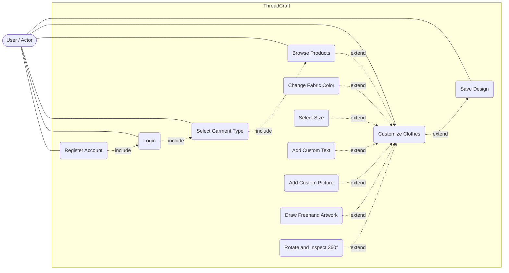

# ThreadCraft Software Requirements Specification (SRS)

Armamento, Kevin · Atinto, Lee Anthony · Beduya, Jewel Anne · Cabrera, Alexandra Nicole

---

## Table of Contents

1. [Introduction](#1-introduction)
2. [Overall Description](#2-overall-description)
3. [Specific Requirements](#3-specific-requirements)
4. [Supporting Information](#4-supporting-information)

---

## 1. Introduction

The Software Requirements Specification (SRS) describes the requirements of ThreadCraft, a web-based apparel customization system. It defines what the system must do, the constraints it must operate under, and the user interfaces it must provide. The detailed requirements of the ThreadCraft are provided in this document.

### 1.1 Purpose

The purpose of this document is to give a complete, and understandable description of the ThreadCraft system. This document will show how the system will be used for the users that will help them for better understanding especially in customizing the clothes. This is intended for the ThreadCraft project team, and the users of the system. Developers will build while the testers of the project will use the Test Case Matrix to verify that each requirement is met to confirm that the system matches what the team agreed to deliver.

### 1.2 Scope

ThreadCraft is a web-based application that lets shoppers and fashion lovers design their own apparel online. The system covers the following:

- Registering an account and logging in
- Selecting a garment type (Hoodie or T-Shirt) and browsing the products available for that type.
- Customizing a garment by choosing the size, color, adding custom text, and drawing freehand artwork.
- Viewing the design on a real time preview on a 2D/3D.
- Saving designs to the user's account.

ThreadCraft does not include a checkout process, payment, shipping, tax calculation, and financing. These are the limitations of the system. The goal of ThreadCraft is to let users visualize and save a personalized garment design.

### 1.3 Definitions, Acronyms, and Abbreviations

| Term | Definition |
|---|---|
| SRS | Software Requirements Specification |
| 2D / 3D | Two-dimensional / three-dimensional |
| ThreadCraft | The web-based apparel customization system described in this document |
| User | Any person who uses ThreadCraft. Also referred to in the use case documents as a Shopper or Fashion Lover |
| Garment | A piece of clothes that can be customized such as Hoodie and T-Shirt |
| Product | A specific garment item listed in the system that the user can view and customize |
| Customization | Any change a user makes to a garment. |
| Design | The clothes with all customizations applied to it by the user |
| Account | A registered user record identified by credentials that can be used to log in and to keep saved designs |

### 1.4 References

- SRS Example: E-Store Project
- ThreadCraft Use Case Diagram
- Laboratory Exercise #2 – Use Case
- ThreadCraft Test Case Matrix

### 1.5 Overview

The remaining sections of this document are organized as follows. Section 2 gives a general description of ThreadCraft, including its perspective, main functions, users, constraints, and assumptions. Section 3 contains the specific requirements: 3.1 Functionality, 3.2 Usability, 3.3 Reliability and Availability, 3.4 Performance, 3.5 Security, 3.6 Supportability and Development Tools, 3.7 Web-Based System Constraints, 3.8 Interfaces, and 3.9 Licensing, Legal, and Applicable Standards. Section 4 lists supporting information, including a table that traces each use case to the requirements and test cases that cover it.

---

## 2. Overall Description

ThreadCraft is a standalone, web-based system that users access through a web browser. It does not replace or depend on an existing e-commerce system, and it does not handle orders or payments. The system is made up of four main parts, a user account for registration, login, and profile management. The system also has an apparel catalog organized by garment type and a customization page with a real time preview. This also has storage for user's saved designs.

---

## 3. Specific Requirements

### 3.1 Functionality

#### 3.1.1 Apparel Customization Engine (Adding text, logos, colors, decals)

The core is to enable the shoppers to dynamically modify the garment attributes, choose garment, select size, change color, input custom text overlays, choose present graphics and perform free hand drawing directly onto the active canvas.

- 3.1.1.1 It provides options to select apparel sizes and fabric color variants updating the base price and real-time summary values.
- 3.1.1.2 It allows users to input up to 30 characters of custom text and position it dynamically (Center, Top, Bottom) on the live SVG garment preview layer.
- 3.1.1.3 The system shall allow users to select from a gallery of preset graphic designs or remove the graphic from the garment canvas instantly.
- 3.1.1.4 It provides an HTML5 canvas drawing overlay with adjustable brush sizes (1px to 30px), clear functionality, and an undo feature to support custom user doodles or signatures.

#### 3.1.2 Product Canvas & Live Preview

The Product Canvas & Live Preview allows users to see how their customized garment looks while they are designing it. The preview changes as the user selects different options and adds designs to the garment.

- 3.1.2.1 The system shall show the selected garment on the customization canvas.
- 3.1.2.2 The system shall update the garment preview when the user changes the size or fabric color.
- 3.1.2.3 The system shall show the custom text, uploaded pictures, and freehand drawings added by the user.
- 3.1.2.4 The system shall provide both 2D and 3D views of the customized garment.
- 3.1.2.5 The system shall allow users to rotate the garment to check their design from different angles.
- 3.1.2.6 The system shall show the updated design before the user saves it.

#### 3.1.3 Apparel Catalog & Categorizations (Hoodies & T-Shirts)

The Apparel Catalog allows users to choose what type of garment they want and browse the available products. The products are grouped into Hoodie and T-Shirt categories to make it easier for users to find what they want.

- 3.1.3.1 The system shall provide Hoodie and T-Shirt categories.
- 3.1.3.2 The system shall allow users to choose a garment type before browsing the products.
- 3.1.3.3 The system shall show products based on the selected garment type.
- 3.1.3.4 The system shall allow users to browse the available garments.
- 3.1.3.5 The system shall allow users to view a product before customizing it.
- 3.1.3.6 The system shall allow users to switch between Hoodie and T-Shirt categories.

#### 3.1.4 Asset & Text Search Facility

The search and filter module enables users to quickly locate specific apparel products and base catalog items such as t-shirts and hoodies without manual scrolling.

- 3.1.4.1 The search and filter module enables users to quickly locate specific apparel products and base catalog items (such as t-shirts, hoodies, and jerseys) without manual scrolling.
- 3.1.4.2 The system shall allow users to filter available apparel products by predefined categories or attributes to streamline product selection before entering the customization studio.

#### 3.1.5 Maintain User Profile & Saved Designs

This feature covers user accounts and supports the Register Account and Login

- 3.1.5.1 The system shall allow a new user to register an account by entering an email address and a password.
- 3.1.5.2 The system shall validate the registration information and notify the user of any missing or invalid entries, or of an email address that is already registered.
- 3.1.5.3 The system shall allow a registered user to log in using the registered credentials.
- 3.1.5.4 The system shall notify the user when the login credentials are incorrect, without stating which credential was wrong.
- 3.1.5.5 The system shall allow a logged-in user to log out.

#### 3.1.6 Design History & Favorites

The system capability that automatically records past design sessions and allows users to bookmark preferred apparel layouts for quick access.

- 3.1.6.1 The system shall automatically save recent design configurations and versions into a user dashboard history log.
- 3.1.6.2 The system shall allow users to mark specific saved designs as favorites using a toggle action (e.g., a heart icon) to store them in a dedicated favorites tab.

#### 3.1.7 Export & Share Customized Designs

This allows Shoppers to save their finished apparel for external export or record-keeping.

- 3.1.7.1 The system shall capture all active configuration parameters including selected pattern style, size, fabric color, custom text input, text position, applied graphics, and freehand drawing overlays into a structured format upon user request.
- 3.1.7.1 The system shall dynamically compile all customized attributes and real-time pricing into a structured design summary viewable prior to final saving or export.

### 3.2 User Interfaces & Usability

#### 3.2.1 Graphical User Interface

The Graphical User Interface provides a simple and organized way for users to use ThreadCraft. It includes the different buttons, menus, and controls needed to browse and customize a garment.

- 3.2.1.1 The system shall use clear labels for buttons, menus, and other controls.
- 3.2.1.2 The system shall provide easy navigation for selecting garments, browsing products, customizing clothes, and saving designs.
- 3.2.1.3 The system shall organize the customization options such as size, fabric color, custom text, pictures, and freehand drawing.
- 3.2.1.4 The system shall show the garment preview while the user is customizing it.
- 3.2.1.5 The system shall show a clear message when the user enters missing or incorrect information.

#### 3.2.2 Accessibility

The Accessibility feature helps make ThreadCraft easier to use and understand for different users. The system shall use simple labels, readable text, and clear controls.

- 3.2.2.1 The system shall use simple and understandable labels for buttons, controls, and input fields.
- 3.2.2.2 The system shall use readable text throughout the system.
- 3.2.2.3 The system shall provide clear feedback when a user selects or changes an option.
- 3.2.2.4 The system shall not use color alone to communicate important information.
- 3.2.2.5 The system shall provide labels or descriptions for important icons and controls.
- 3.2.2.6 The system shall keep the interface usable on supported screen sizes.

### 3.3 Reliability & Availability

#### 3.3.1 System Availability

- The system shall run on a web server with server-side scripting and MySQL support.
- The system shall display a clear error message when the server or database cannot be reached, instead of a blank or broken page.

#### 3.3.2 Data Reliability

- The system shall store all user accounts and saved designs in a database.
- The system shall retain a user's saved design until the user deletes it.

#### 3.3.3 Fault Tolerance

- The system shall preserve the user's current customization in the browser if the Save Design request fails, so the work is not lost before a retry.
- The system shall reject an image upload that fails validation without affecting the rest of the design in progress.

### 3.4 Performance

#### 3.4.1 Canvas Rendering

- The system shall reflect changes made with Change Fabric Color, Add Custom Text, Add Custom Picture, and Draw Freehand Artwork on the preview canvas as quickly as the user's device allows.
- The system shall update the preview promptly when the user uses Rotate & Inspect 360°.
- The system shall draw freehand artwork as the pointer moves.
- The system shall support a reasonable number of design elements (text, images, strokes) on the canvas.

#### 3.4.2 Image Asset Upload

- The system shall accept JPG and PNG uploads for Add Custom Picture up to a maximum file size set in the system configuration.
- The system shall check file type and size in the browser before uploading, so invalid files are rejected without transferring them.
- The system shall show upload progress and shall display the image on the canvas as soon as the upload completes.
- The system shall reduce the dimensions of oversized images to a configurable maximum.
- The system shall complete Save Design in a reasonable time and shall show a "saved" status when it finishes.

### 3.5 Security

#### 3.5.1 Data Transfer

- The system shall use server-side sessions to keep a user logged in after a successful login.
- The system shall automatically end a session after 30 minutes of inactivity.
- The system shall not store passwords or other confidential account data in cookies or browser storage.

#### 3.5.2 Account Data Storage

- The system shall store passwords only as hashes and never in plain text.
- The system shall mask the password field while it is being typed and shall never display a stored password.
- The system shall allow a logged-in user to access only their own saved designs.

#### 3.5.3 Asset Storage

- The system shall store uploaded images under randomly generated unique file names instead of the user's original file names.
- The system shall accept only JPG and PNG uploads within the set maximum file size.
- The system shall serve uploaded images and saved designs only through authenticated requests from the owning user.
- The system shall not execute any uploaded file as a script.

### 3.6 Supportability & Development Tools

- The system shall integrate automated error logging to capture and track failed asset uploads, rendering errors, and API request issues.

### 3.7 Web-Based System Constraints

- The system shall be accessed through a compatible web browser.
- The system shall require a network connection to use the web-based system.
- The system shall allow users to customize garments through the web browser.
- The system shall support the 2D and 3D preview of customized garments.
- The system shall store user account information and saved designs in the database.
- The system shall keep the user's current design while they are customizing the garment.
- The system shall not include checkout, payment, shipping, tax calculation, or financing since these are outside the scope of ThreadCraft.

### 3.8 System Interfaces

#### 3.8.1 User Interfaces

- Register Account - Allows new user to create account.
- Login - Allows registered user to access the system.
- Select garment type - Allows user to choose between hoodies or T-shirt.
- Browse product - Shows the available garment for the selected type.
- Customize garments - Allows the user to change fabric color, size and too add picture or draw freehand artwork.
- Rotate & Inspect 360° - Allows users to rotate the garment and view the design from the different angle.
- Save design - Allows the user to save their completed customized garments.

#### 3.8.2 Hardware Interfaces

- The system shall support mouse and keyboard input on desktop, and touch input on mobile and tablet, including drag, tap, and finger or stylus drawing on the canvas.
- The system shall provide rotation buttons and keyboard controls to drag to rotate.
- The system shall let users upload images from their device's local storage, such as a file folder, using the browser's standard file picker.
- The system shall not require audio hardware, a camera, or any other special peripherals.
- The system requires an internet connection.

#### 3.8.3 Software Interfaces

- The system shall run in current versions of browsers such as Chrome, Firefox, and Edge, with JavaScript enabled.
- The system shall use HTML, CSS, and JavaScript for the user interface and shall draw the customization preview using Canvas/SVG layering.
- The system shall store user accounts and saved designs in a MySQL database, accessed through prepared statements.
- The system shall use a database administration tool (e.g., phpMyAdmin) for backups.

#### 3.8.4 Communications Interfaces

- The system shall use HTTPS for all communication between the browser and the server in the deployed version. Plain HTTP is allowed for local development and testing only.
- The system shall use HTTP status codes to report success or failure and shall show the user a readable message on failure.
- The system shall maintain the user's logged-in state through a session cookie, as specified in 3.5.1.
- The system shall keep the data sent between browser and server small enough to work on normal broadband connections, as described in 3.4.

### 3.5 Licensing, Legal, and Applicable Standards

#### 3.5.1 Asset and Font Licensing

- The system shall use only free or open-source libraries whose licenses allow use in a project, and shall keep their license notices.
- The project shall keep a record of the source and license of each third-party asset, font, and library.

#### 3.5.2 User-Uploaded Content and Legal Notices

- The system shall display an upload disclaimer stating that users are responsible for having the right to use their images and that copyrighted or inappropriate images must not be uploaded.
- The system shall use uploaded images only to display and save the uploading user's own designs.
- The system shall collect only the personal information needed for Register and Login.
- The system shall ensure the secure handling and protection of customer personal information and user data privacy.
- The system shall display copyright and attribution notices for third-party assets and libraries where their licenses require it.

#### 3.5.3 Applicable Standards

- The system shall follow current web standards for HTML, CSS, and ECMAScript (JavaScript).
- The system shall follow responsive web design practices.
- The system shall accept JPG and PNG images only.
- The system shall follow the security practices in 3.5, including HTTPS for data transfer and hashed passwords.

---

## 4. Supporting Information

This section lists the references used in preparing this SRS

### Use Case Diagram

### Use Cases

#### Craft_001: Select a Garment

| Field | Details |
|---|---|
| Use Case ID | Craft_001 |
| Use Case Name | Select a Garment |
| Actors | Shoppers/Fashion Lovers |
| Description | They will select a garment such as hoodie or tshirt |
| Trigger | Shoppers wishes to see the products they can customize |
| Preconditions | Shoppers is on the ThreadCraft Homepage |
| Postconditions | The selected garment category has been set |
| Basic Flow | 1. Shoppers enters the ThreadCraft garment selection 2. Shoppers see the garments type 3. Shoppers select a garment (Hoodie or T-Shirt) 4. Shoppers will proceed to browse product that only shows their selected garment type |
| Alternative Flows | A1. The selected garment type is pressed accidentally but the user doesn't want it, a button will be seen on the side so that they can switch garment type |
| Assumptions | Shoppers can change their garment type anytime they want |
| Notes and Issues | N/A |

#### Craft_002: Browse Products

| Field | Details |
|---|---|
| Use Case ID | Craft_002 |
| Use Case Name | Browse Products |
| Actors | Shoppers and Fashion lovers |
| Description | Browse Product List (Shirts and Hoodies) |
| Trigger | Shoppers wants to browse the garments |
| Preconditions | Shoppers wish to look over the garments |
| Postconditions | Shoppers have reviewed the garments |
| Basic Flow | 1. Shoppers want to browse the garments 2. Shoppers press the "Browse" button 3. Shoppers is currently browsing the garments 4. Shoppers can press the "View" button to see the product details of each garments 5. Shoppers have reviewed the garments |
| Alternative Flow | A1. The "Browse" button is pressed (Step 2) If the Shopper does not want to Browse then the shopper will remain in the homepage. A2. The "View" button is pressed (Step 4) if the Shopper does not want to view, they will remain on the browse product page. |
| Assumptions | Shoppers can only view one product at a time. |
| Notes and Issues | N/A |

#### Craft_003: Customize Clothes

| Field | Details |
|---|---|
| Use Case ID | Craft_003 |
| Use Case Name | Customize Clothes |
| Actors | User |
| Description | Allow shoppers to customize clothes |
| Trigger | Shoppers wishes select garment |
| Preconditions | Shoppers have selected a garment type and navigated through the product. |
| Postconditions | Shoppers design is ready to be saved |
| Basic Flow | 1. Shoppers Select garment 2. Select custom size 3. Select fabric color 4. Add custom text 5. Add picture or draw freehand design 6. Shoppers can rotate and inspect 360° |
| Alternative Flows | 1. Select Garment 2. Select size 3. Select color 4. Add custom text 5. Add picture 6. Draw freehand design 7. Rotate and inspect 360° |
| Assumptions | The system supports real-time 2d/3d rendering for smooth design updates. |
| Notes and Issues | N/A |

### Test Cases Matrix

#### Use Case: Craft_001 - Select a Garment

| Test Case ID | Test Case Description | Test Case Procedure | Input Value/s | Expected Output/Result |
|---|---|---|---|---|
| TC_CRAFT_001_01 | Select Garment Category - Basic Flow (Hoodie) | 1. Navigate to the ThreadCraft Homepage. 2. Enter the Garment Selection section. 3. Click on the "Hoodie" garment category option. | Navigation: Homepage Selection: "Hoodie" | The garment category is set to "Hoodie". Users are redirected to the product catalog displaying only Hoodie products. |
| TC_CRAFT_001_02 | Select Garment Category - Basic Flow (T-Shirt) | 1. Navigate to the ThreadCraft Homepage. 2. Enter the Garment Selection section. 3. Click on the "T-Shirt" garment category option. | Navigation: Homepage Selection: "T-Shirt" | The garment category is set to "T-Shirt". The user is redirected to the product catalog displaying only T-Shirt products. |
| TC_CRAFT_001_03 | Switch Garment Category via Side Button (Alt Flow A1) | 1. Navigate to Garment Selection. 2. Accidentally click "T-Shirt". 3. Click the "Switch Garment Type" button on the side panel. 4. Select "Hoodie". | Initial: "T-Shirt" Action: Click "Switch Garment Type" New Selection: "Hoodie" | The system resets garment selection. The user successfully switches to the "Hoodie" view. |

#### Use Case: Craft_002 - Browse Products

| Test Case ID | Test Case Description | Test Case Procedure | Input Value/s | Expected Output/Result |
|---|---|---|---|---|
| TC_CRAFT_002_01 | Browse Product List - Basic Flow | 1. Navigate to Homepage. 2. Click the "Browse" button. 3. Scroll through the displayed garment list. | Click: "Browse" button Action: Scroll Page | System transitions to Browse Products page displaying list of available garments |
| TC_CRAFT_002_02 | View Product Details - Single Item Inspection | 1. On the Browse Products page, locate product items. 2. Click the "View" button under the item card. | Product ID: "HD-0101" Click: "View" button | System opens a detailed view for "Oversized Classic Hoodie" showing images, and customization entry point. |
| TC_CRAFT_002_03 | Cancel Browse Action (Alt Flow A1) | 1. Hover over the "Browse" button on the Homepage. 2. Do not complete click action / navigate away or press Home logo. | Action: Cancel / Non-navigation | User remains on ThreadCraft Homepage. No state change occurs. |
| TC_CRAFT_002_04 | Decline Viewing Item Details (Alt Flow A2) | 1. On the Browse Products page, review garment cards. 2. Refrain from clicking the "View" button / close preview modal. | Action: Close modal / No view selection | The user remains on the Browse Products page to continue reviewing other garments. |

#### Use Case: Craft_003 - Customize Clothes

| Test Case ID | Test Case Description | Test Case Procedure | Input Value/s | Expected Output/Result |
|---|---|---|---|---|
| TC_CRAFT_003_01 | Full Clothes Customization - Basic Flow | 1. Select garment. 2. Select custom size. 3. Select fabric color. 4. Add custom text. 5. Upload picture. 6. Rotate 360° to inspect the design. 7. Save design. | Garment: Hoodie Size: L Color: Blue Text: "THREADCRAFT 2026" Upload picture Rotation: 360° Drag | Real-time 2D/3D model renders all customization inputs accurately. Design status updates to "Ready to be saved". |
| TC_CRAFT_003_02 | Freehand Drawing Customization (Alt Flow) | 1. Select garment. 2. Select size & color. 3. Select the "Draw Freehand" tool. 4. Draw custom graphics on canvas. 5. Rotate 360° to inspect. 6. Save design. | Garment: T-Shirt Size: M, Color: White Tool: Freehand Brush Stroke: Black Rotation: Interactive 360° | Freehand artwork renders smoothly onto 2D/3D surface texture in real time. Design successfully saved. |
| TC_CRAFT_003_03 | Custom Text & Image Combination with 360° Inspection | 1. Select garment. 2. Set size and fabric color. 3. Enter custom text in front. 4. Upload image badge on sleeve. 5. Perform 360° rotation to inspect the full garment. | Garment: Hoodie Text: "URBAN STYLE" (Impact, 24pt) Upload picture View Angle: Front and Back | Both text and uploaded image map to 3D geometry |