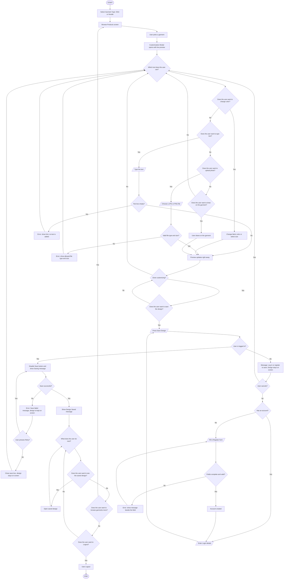

# ThreadCraft: Project Part 2 Design Process Portfolio

Armamento, Kevin · Atinto, Lee Anthony · Beduya, Jewel Anne · Cabrera, Alexandra Nicole

---

## Table of Contents

1. [Project Identity and Part 1 Handoff](#1-project-identity-and-part-1-handoff)
2. [Content Inventory and Information Structure](#2-content-inventory-and-information-structure)
3. [Primary User Flow](#3-primary-user-flow)
4. [Wireframe](#4-wireframe)
5. [Visual Interface Direction](#5-visual-interface-direction)
6. [Media Asset Plan and Production Record](#6-media-asset-plan-and-production-record)
7. [Design Rationale](#7-design-rationale)
8. [Individual Contribution Record](#8-individual-contribution-record)
9. [Sources, Attribution, and AI Disclosure](#9-sources-attribution-and-ai-disclosure)

---

## 1. Project Identity and Part 1 Handoff

| Item | Details |
|---|---|
| Current Project Title | ThreadCraft |
| Member Names | Kevin Armamento, Lee Anthony Atinto, Jewel Anne Beduya, Alexandra Nicole Cabrera |
| Submission Date | October 16, 2026 |
| One Sentence Concept Statement | ThreadCraft Studio is a browser-based interactive web application where fashion lovers and online shoppers can design a custom shirt or hoodie using colors, text, pictures, and freehand drawing. They can rotate the clothes to inspect it in real time. |
| Primary Audience | Everyday online shoppers and fashion lovers who enjoy customizing their own clothes and already know e-commerce apps like Shopee, Lazada, or Instagram shops. |
| Primary User Goal | Customize a shirt or hoodie using colors, text, and graphics, and inspect the design in real time before saving it. |

In Part 1, we found that many people want to design their own clothes but they don't have an easy and beginner friendly tool for it, and they can't see how their idea will look on a finished garment before they decide. Our answer is a browser-based interactive experience that shows every change on a live preview right away. The scope of our idea is that we only covers shirt and hoodie. We don't cover other garment types, advanced account features, full product catalog with search and filter, full 3D/WebGL modeling, and cart, checkout and payment.

---

## 2. Content Inventory and Information Structure

| Content ID | Content Item | Purpose | Intended Location | Format or Media | Source or Owner | Status |
|---|---|---|---|---|---|---|
| HDR-01 | Logo & Subtitle | Displays brand identity | Top Navigation Bar (Left) | Image (PNG) and Heading Text | Graphic Designer | Need Revision |
| CARD-01 | Sample Display Card | Previews a sample finished apparel design | Main Content Grid (Left) | Image (PNG) and Text Label | Content Creator | Ready |
| CARD-02 | Classic T-Shirt Product Card | Displays base T-Shirt mockup, price (₱350.00), and customize action | Main Content Grid (Center) | Image (PNG), Text and Button | Product Manager | Need Revision |
| CARD-03 | Classic Pullover Hoodie Product Card | Displays base Hoodie mockup, price (₱650.00), and customize action | Main Content Grid (Center) | Image (PNG), Text and Button | Product Manager | Need Revision |
| BTN-01 | "Select & Customize" Button (T-Shirt) | Launches the interactive design editor for the Classic T-Shirt | Card Footer | Interactive Button | UI/UX Designer | Ready |
| BTN-02 | "Select & Customize" Button (Hoodie) | Launches the interactive design editor for the classic Hoodie | Card Footer | Interactive Button | UI/UX Designer | Ready |
| PREV-01 | Interactive Apparel Mockup | Renders real-time visual preview of selected shirt, pattern, color, text, and artwork | Left Column (Apparel Preview Section) | Canvas / Dynamic SVG / Image | Frontend Developer | Ready |
| TXT-01 | Current Price Label | Displays real-time dynamically calculated total cost below preview | Left Column (Below Mockup) | Text | System | Ready |
| BTN-3 | Back to products | Returns the user to the Home Page product catalog | Bottom-Left Corner | Interactive Button | UI/UX Designer | Need Revision |
| OPT-01 | Choose Pattern Style | Allows selection of base pattern | Right Panel (Section 1) | Image Options and Pricing Labels | UI/UX Designer | Planned |
| OPT-02 | Choose Size | Selects product sizing | Right Panel (Section 2) | Selector Buttons and price labels | UI/UX Designer | Ready |
| OPT-03 | Choose Fabric Color | Selects base garment fabric color via visual swatches | Right Panel (Section 3) | Color Swatch Palette | Graphic Designer | Ready |
| INP-01 | Add Custom Text Input & Position | Input field for custom text and position dropdown selector | Right Panel (Section 4) | Text Input Field and Select Dropdown | Frontend Developer | Ready |
| OPT-04 | Add Graphic | Grid of selectable graphic assets to overlay on apparel | Right Panel (Section 5) | Image Grid Buttons | Graphic Designer | Need Revision |
| TOOL-01 | Freehand Drawing Studio | Drawing tools including Brush Size slider, Clear Drawing, and Undo buttons | Right Panel (Section 6) | Interactive Canvas Tool Controls | Frontend Developer | Need Revision |
| SUMMARY-01 | Price Breakdown | Itemized cost summary breakdown | Right Panel (Section 7) | Dynamic Text List | System | Need Revision |
| BTN-04 | Design Configuration | Controls to persist custom designs to local storage/database or clear current setup | Right Panel (Section 8) | Interactive Button Group | Full-Stack Developer | Drafting |
| SUMMARY-02 | Design Summary | Displays text summary of current custom selections | Right Panel Footer | Text List | System | Need Revision |

---

## 3. Primary User Flow

### ThreadCraft Studio: Primary User Flow

The primary user flow of the system is that the user opens ThreadCraft Studio without needing an account, selects Shirt or Hoodie, browses the garments and picks one. The customization modal will open with a live preview. The user changes the fabric color and size, adds text, uploads a picture or draws, and rotates the garment to check every side. Each change shows on the preview right away. When done, the user presses Save Design. If the user is not logged in yet, the system asks them to log in or register, and after that the user goes back to saving with the design still on the screen. They can then open the saved design again, which shows the same color, size, text, picture and artwork.

---

## 4. Wireframe

Add the exported wireframe images to an `images/` folder in the repo, using the file names below, so the links resolve.

### Desktop

#### Login

#### Signup

#### Homepage

#### Customize part 1

#### Customize part 2

#### Customize part 3

### Mobile

#### Login

#### Signup

#### Homepage part 1

#### Homepage part 2

#### Customize part 1

#### Customize part 2

#### Customize part 3

### Desktop Responsive Annotations

#### 1. Header Navigation & Unauthenticated Access

- Layout & Placement: Fixed top navbar stretching across wide screens. The ThreadCraft logo is left-aligned, while Login and Register buttons are right-aligned.
- User Flow Behavior: Guest users can freely view the homepage catalog and enter the customization studio without logging in first.

#### 2. Desktop Login & Signup Modals

- Layout & Placement: Centered modal overlaid on a full-screen dimmed background.
- Structure: Formatted as a side-by-side two-column split. The left column holds a large branding image placeholder, and the right column contains labeled form fields (username, password, confirm password), links (sign up, Login), and submit buttons.

#### 3. Desktop Homepage Showcase

- Layout & Placement: Multi-column horizontal catalog layout.
- Structure: Displays a wide 3-column grid featuring a hero promo banner next to product card slots (Shirts, Hoodies), each with an explicit Customize button.

#### 4. Desktop Customization Studio (Parts 1–3)

- Layout & Placement: Wide two-column split-screen layout maintaining persistent visual feedback.
- Left Column (Persistent Canvas): Displays a large, fixed Apparel Preview canvas with rotation controls underneath, staying visible at all times as the user edits.
- Right Column (Tool Control Panels): Arranges numbered configuration toolbars sequentially:
  - Part 1: 1. Choose Size, 2. Choose Fabric Color, 3. Add Custom Text.
  - Part 2: 4. Add Graphic, 5. Freehand Drawing Studio (brush slider, Clear, Undo), 6. Price Breakdown.
  - Part 3: 7. Design Configuration with stacked CTA buttons (Save Design, Load Saved Design, Reset Design).
- Auth Gate on Save: Clicking Save Design checks if the user is signed in. If unauthenticated, it opens the Login / Signup modal before preserving and saving the user's artwork.

### Mobile Responsive Annotations

#### 1. Header Navigation & Unauthenticated Access

- Responsive Reflow: Header height and element padding compress to fit narrow mobile viewports.
- User Flow Behavior: Unauthenticated users maintain full guest access to browse products and design apparel on mobile before sign-in.

#### 2. Mobile Login & Signup Screens

- Responsive Reflow: The desktop two-column modal converts into a single-column, full-width vertical stack.
- Structure: Branding image placeholders scale down above the form inputs (username, password, confirm password). All text fields and submit buttons expand to 100% viewport width for easy thumb interaction.

#### 3. Mobile Homepage (Part 1 & Part 2)

- Responsive Reflow: The desktop 3-column product grid collapses into a single-column, vertically scrollable list split across screen views:
  - Homepage Part 1: Houses the compressed top header and full-width promo hero banner.
  - Homepage Part 2: Vertically stacks individual product cards with enlarged Customize buttons.

#### 4. Mobile Customization Studio (Parts 1–3)

- Responsive Reflow: The desktop side-by-side split reflows into a single-column vertical stack separated into 3 scrollable viewports to maximize mobile screen space:
  - Customize Part 1: Dedicated to a high-visibility Apparel Preview canvas with rotation controls.
  - Customize Part 2: Vertically stacks tool panels 1. Size, 2. Color, 3. Text, and 4. Graphic directly below the canvas area.
  - Customize Part 3: Expands 5. Freehand Drawing Studio controls (Clear, Undo, brush slider) to full screen width for precise touch/stylus drawing, followed by 6. Price Breakdown and full-width CTA buttons in 7. Design Configuration (Save Design, Load Saved Design, Reset Design).
- Auth Gate on Save: Clicking Save Design redirects unauthenticated mobile users to the mobile Login / Signup screen, returning them directly back to their active canvas upon successful login.

---

## 5. Visual Interface Direction

### Color Palette with Values

| Role | Name | Hex | Description |
|---|---|---|---|
| Primary Background | Warm Studio Linen | `#F6F4EE` | Soft, modern warm linen backdrop that mimics a clean fashion design workspace and fabric cutting table. |
| Secondary Surface | Tailor Slate / Dark Indigo | `#1E232A` | Deep slate-charcoal used for navigation bars, modal dialogs, and main tool panels to create a sharp, professional contrast. |
| Interactive Accent | Terracotta Thread | `#E06D53` | Warm, vibrant terracotta rust inspired by garment stitching threads; used for primary call-to-action buttons (Save Design, Customize) and key tool selection highlights. |
| Secondary Accent | Raw Canvas Cream | `#EFEAE1` | Soft neutral container fill for tool panels, size selection boxes, and form inputs. |
| Garment Canvas Highlight | Pure White | `#FFFFFF` | Bright, clean white canvas surface framing the live Apparel Preview, ensuring true color representation of custom clothes. |
| Primary Text | Charcoal Ink | `#181A1D` | Crisp, dark charcoal text for titles, body labels, and step headings on light surfaces. |
| Contrast Text | Warm Milk | `#FDFBF7` | Soft off-white text for labels inside dark header bars and Terracotta buttons. |

### Typography Choices

- Font Family: Plus Jakarta Sans or Inter (Modern, aesthetic sans-serif with editorial fashion feel).

| Style | Size / Weight | Used For |
|---|---|---|
| Heading 1 (H1) | 24px / Bold (700) | Primary section titles (Apparel Preview) and modal headers |
| Heading 2 (H2) | 16px / Semi-Bold (600) | Numbered step titles (1. Choose Size, 2. Choose Fabric Color) |
| Body & Control Labels | 14px / Medium (500) | Form field labels (username:, password:), button text, and price breakdowns |
| Captions & Secondary Actions | 12px / Regular (400) | Helper text, subtle warnings, and sub-actions (Clear, Undo) |

### Spacing and Layout Rules

- Spacing System: Based on a strict 8pt spatial grid (8px, 16px, 24px, 32px) for consistent margins, gaps, and breathing room.
- Border Radius: 16px rounded corners for modal windows and preview cards, with 24px smooth pill borders for interactive controls and buttons.
- Desktop Layout Rules: Side-by-side two-column split layout with a large, dedicated preview canvas (480px) on the left and a scrollable studio tool panel on the right.
- Mobile Layout Rules: Single-column vertical stack with 16px outer margins, allowing controls to wrap gracefully under the preview screen on smaller mobile viewports.

### Button and Control Styles

- Primary CTA Buttons (Save Design, Customize): Terracotta Thread `#E06D53` background with Warm Milk `#FDFBF7` bold text.
- Secondary CTA Buttons (Load Saved Design, Reset Design): Dark Slate `#1E232A` background with `#FDFBF7` text.
- Action Controls (Clear, Undo, Remove Graphic): Delicate outlined pill buttons in `#181A1D` with subtle hover fills.
- Form Input Fields: Raw Canvas `#EFEAE1` background with `#181A1D` text and 10px inner padding for a sleek, tactile feel.

### Image, Illustration, and Icon Direction

- Apparel Canvas Overlays: High-definition 2D vector garment mockups (T-shirts, Hoodies) with realistic fabric texture shading and SVG transparency for instant live color rendering.
- Iconography: Minimalist, editorial stroke icons (scissors, thread needle, color swatches, brush size indicators) using `#181A1D` or `#FDFBF7`.

### Examples of Important Component States

- Default State: Raw Canvas `#EFEAE1` fill for unselected options, sizes, and tools.
- Hover State (Desktop): Terracotta and Dark Slate buttons shift 10% in brightness on cursor hover to signal interactive touchpoints.
- Active / Selected State: Solid 2px Terracotta `#E06D53` outline stroke around chosen fabric colors, active apparel sizes, or selected drawing tools.
- Disabled State: 35% opacity on action buttons before a garment is customized or edited.
- Focus State: 2px Terracotta outline around text input boxes when active.

### Contrast and Readability Evidence

| Pairing | Contrast Ratio | Result |
|---|---|---|
| Warm Studio Linen (`#F6F4EE`) vs. Charcoal Ink Text (`#181A1D`) | 15.8:1 | Exceeds WCAG AAA requirements |
| Terracotta CTA (`#E06D53`) vs. Warm Milk Text (`#FDFBF7`) | 4.8:1 | Passes WCAG AA requirements for bold UI buttons |
| Dark Slate Navbar (`#1E232A`) vs. Warm Milk Text (`#FDFBF7`) | 16.1:1 | Exceeds WCAG AAA requirements |

### Defensible Design Rationale

#### Supporting the Intended Audience

- The warm linen background (`#F6F4EE`) paired with terracotta accents (`#E06D53`) evokes the feel of a modern fashion atelier, craft studio, or boutique custom apparel workshop.

#### Supporting the Project's Purpose

- Framing the custom garment on a pure white preview card (`#FFFFFF`) guarantees true color accuracy for fabric dyes, custom text, uploaded graphics, and artwork.

#### Supporting Readability

- High-contrast text pairings ensure that garment sizes, pricing breakdowns, and customization instructions remain effortlessly readable across all screen brightness levels.

#### Supporting Visual Hierarchy

- Terracotta accents draw the eye directly to high-priority interactive controls (1. Choose Size, Save Design), while neutral canvas tones keep secondary configuration options clean and uncluttered.

#### Supporting Interaction Feedback

- Distinct active border strokes (2px Terracotta) and clear hover transitions give users immediate visual confirmation as they pick fabric colors, toggle sizes, or draw on garments.

#### Supporting Accessibility

- Tactile pill-shaped controls and full-width buttons exceed 44 × 44px touch target standards, making design tools easy to tap on smartphones or click on desktop computers.

#### Supporting the Expected Device and Environment

- The warm studio aesthetic scales seamlessly from wide desktop workstations down to mobile phone screens (Parts 1–3), delivering an elegant, boutique custom apparel experience on any device.

---

## 6. Media Asset Plan and Production Record

| Asset ID | Asset and Purpose | Source or Creator | Editable Source | Export Format | Dimensions, Durations, or Size | Accessibility Alternative | Status |
|---|---|---|---|---|---|---|---|
| AST-01 | Arrow.png, Button for rotate garment | External / egorpolyakov | Vector/PNG Source | PNG | 32 x 32 px | "360 Rotate garment" | Planned |
| AST-02 | edit.png, Button for editing garments | Flaticon / Pixel perfect | Vector/PNG Source | PNG | 32 x 32 px | "Edit garment" | Planned |
| AST-03 | Eye.png, Button show password text | External / Gregor Cresnar | Vector/PNG Source | PNG | 24 x 24 px | "View Password" | Planned |
| AST-04 | Hidden.png, Button hide password text | External / Sonnycandra | Vector/PNG Source | PNG | 24 x 24 px | "Hide Password" | Planned |
| AST-05 | ThreadCraft (Logo).svg, Brand Logo navigation | Original Team Asset | SVG Vector | SVG | Scalable Vector | "ThreadCraft Logo" | Planned |
| AST-06 | Futuristic Sneakers on Orange Background.png, Display graphic style | External / Rena | High-Res Raster | PNG | 120 x 120 px | "Display graphic style on t-shirt" | Planned |
| AST-07 | User.png, Navigation user profile / login action | Flaticon / Magnific | Vector/PNG Source | PNG | 32 x 32 px | "User Profile / Login Account" | Planned |
| AST-08 | Download.png, Save and download garment design button | Flaticon / Pixel perfect | Vector/PNG Source | PNG | 32 x 32 px | "Save and Download Design" | Planned |
| AST-9 | Save.png, Save current design configuration button | Flaticon / inkubators | Vector/PNG Source | PNG | 32 x 32 px | "Save Design" | Planned |

---

## 7. Design Rationale

Each member wrote their own rationale.

### Jewel Anne Beduya's Design Rationale

The biggest thing that shaped our design is target users. ThreadCraft Studio is for everyday online shoppers, mostly students and Gen Z, who already use apps like Shopee and Lazada but are not designers. Because of this, we kept the main flow short, and users can start designing without an account. The system only asks them to register or log in when they press Save Design, so nobody needs design software experience or has to sign up before trying the tool. We put the garment preview first because the problem is that people cannot see how their idea will look before deciding. The tools sit beside the preview so every change is seen right away. The five main tools are kept at the same level so first-time users can find them without instructions.

### Alexandra Nicole Cabrera's Design Rationale

The design of ThreadCraft Studio focuses on helping users customize their own shirts and hoodies. Since the website has different customization tools, these are arranged properly so users can work on their designs without confusion. The live preview is an important part of the design because it shows the changes made to the garments right away. The color options, text input, add picture, and drawing tools also give users different ways to create their designs. Users can start customizing without logging in and only need to register or log in when saving their work. This setup makes the website more convenient for users who want to try designing their own clothes.

### Lee Anthony Atinto's Design Rationale

ThreadCraft's main focus in designing was making sure the user experience felt clean, responsive, and easy to navigate on both desktop and mobile screens. I wanted users to have instant visual feedback, so the live apparel preview stays prominent while they pick colors, edit text, add graphics, or draw freely. To remove friction, shoppers can jump straight into customizing shirts or hoodies without creating an account first. We only ask them to log in or register when they click "Save Design," ensuring their progress is saved smoothly. By using clear control buttons, responsive layouts, and simple tools, anyone can design custom clothes effortlessly

### Kevin Armamento's Design Rationale

ThreadCraft is designed to be easy to use even for people who have never designed anything before. Most of ThreadCraft's targets are online shoppers who want to make their own shirt or hoodie. The designed layout is simple and the tools are easy to find. The tools are placed beside the preview so users do not have to look away from their design while they work. Users can also start designing without an account. They only need to register or log in when they press Save Design. This way, trying the tool is quick and easy, and their finished work is still saved. In the end, the design lets users spend their time on their ideas and not on figuring out how the website works.

---

## 8. Individual Contribution Record

### Section Owners

| Section | Owner |
|---|---|
| 1. Project Identity and Part 1 Handoff | Jewel Anne Beduya |
| 2. Content Inventory and Information Structure | Lee Anthony Antino |
| 3. Primary User Flow | Jewel Anne Beduya |
| 4. Wireframes | Lee Anthony Atinto |
| 5. Visual and Interface Direction | Kevin Armamento |
| 6. Media Asset Plan and Production Record | Alexandra Nicole Cabrera |
| 7. Design Rationale | All members |
| 8. Individual Contribution Record | All members |
| 9. Sources, Attribution, and AI Disclosure | All members |

### Jewel Anne Beduya

| Category | Details |
|---|---|
| Tasks I completed | Wrote Project Identity and Part 1 Handoff and Created the Primary User Flow. Wrote my own Design Rationale, Contribution Record, and Sources. |
| Files or components I created | User Flow Diagram: PrimaryUserFlow.png, PrimaryUserFlow2.png |
| Media assets I produced or edited | None since my parts only use a diagram I made from draw.io |
| Decisions I made | Kept the flow based on the Part 1 In Scope list. Made the flow open to guests, so that they can register and login whenever the user wants and if only when the user saves a design. Locked the Save button while saving. |
| Feedback I contributed | I contributed about the user flow design when we had a meeting. |

### Lee Anthony Atinto

| Category | Details |
|---|---|
| Tasks I completed | Created section 2 (Content Inventory and Information Structure) and section 4 (Wireframes). Wrote my own Design Rationale, Individual Contribution Record, and Sources. |
| Files or components I created | Wireframe diagrams for Desktop and Mobile layouts (Desktop_Login.png, Desktop_Homepage.png, Desktop_Customize.png, Mobile_Login.png, Mobile_Homepage.png, Mobile_Customize.png). |
| Media assets I produced or edited | Sourced and assigned interactive UI icons (Arrow.png, eye.png, hidden.png, Futuristic Sneakers on Orange Background.png, Download.png, Save.png). |
| Decisions I made | Designed desktop and mobile wireframes with side-by-side split canvas views on desktop and single-column stacked views on mobile. Structured content inventory items sequentially from 1 to 7 to ensure clear step-by-step customization. |
| Feedback I contributed | Contributed feedback on the responsive wireframe layouts and login integration. |

### Kevin Armamento

| Category | Details |
|---|---|
| Tasks I completed | Created Section 5 (Visual and Interface Direction). Wrote my own Design Rationale, Individual Contribution Record, and Sources. |
| Files or components I created | Color palette with values, spacing and layout rules, button and control styles, image and icon direction. |
| Media assets I produced or edited | None, since my part only sets the direction for images and icons. |
| Decisions I made | For Section 5, I suggested Jakarta Sans or Inter for the text, and rounded buttons. These were ideas I shared with the group, and the final choices were made together. |
| Feedback I contributed | I shared ideas about the colors, fonts, and button styles during our meeting so they would fit the wireframes and the overall look of the site. |

### Alexandra Nicole Cabrera

| Category | Details |
|---|---|
| Tasks I completed | Created Section 6 (Media Asset Plan and Production Record), listing the media assets needed for ThreadCraft Studio and their purposes, sources, formats, dimensions, accessibility alternatives, and status. |
| Files or components I created | Media Asset Plan and Production Record, including the asset list from AST-01 to AST-09. |
| Media assets I produced or edited | Organized and documented the planned media assets for the website, including icons for garment rotation, editing, password visibility, user profile, saving, downloading, and the ThreadCraft logo. |
| Decisions I made | Identified the media assets needed for the website and documented their sources, editable formats, export formats, dimensions, and accessibility alternatives to support consistent use throughout the interface. |
| Feedback I contributed | Contributed to the documentation of media assets to ensure that the icons and graphics match the website's features and support a consistent user experience. |

---

## 9. Sources, Attribution, and AI Disclosure

1. Project Part 1 Framing and Design Brief
2. Kang, H. J., Shin, J.-H., & Ponto, K. (2020). How 3D virtual reality stores can shape consumer purchase decisions: The roles of informativeness and playfulness. Journal of Interactive Marketing, 49, 70–85. https://www.sciencedirect.com/science/article/abs/pii/S1094996819300921